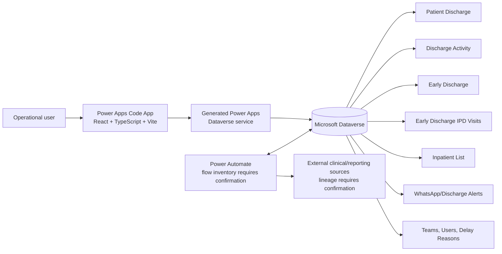

# Patient Discharge / Early Discharge Management System

## Complete Project Documentation and Handover Report

**Report date:** 13 October 2026  
**Development status:** **In Development**  
**Current phase:** Functional implementation and business validation  
**Primary audience:** Project management, business analysis, operational owners, Power Platform administrators, and the incoming development/support team

---

## 1. Executive summary

The Patient Discharge / Early Discharge Management System supports the hospital discharge cycle from the initial discharge request through the operational activities required to complete a patient's discharge. Its purpose is to give clinical and operational teams one place to see each case, its current activity, elapsed time, delay information, alerts, and supporting patient data. The solution also provides an Early Discharge process for preparing future discharges and an Egypt-specific Delayed Cases view for monitoring cases whose clinical-to-physical discharge time exceeds 120 minutes.

The project began with KSA/AHJ discharge operations and is being expanded and adapted for Egypt, covering ASH, SMH, and AMH. The solution historically used a Model-Driven App. A React and TypeScript Power Apps Code App has since been built to provide a more unified, responsive, and purpose-specific interface over Microsoft Dataverse.

The project is still in development. The previous major dependency was the absence of Egypt data sources equivalent to the KSA inpatient and medication sources. The implementation has progressed beyond that original blocker, and the current primary dependency is operational validation. Some remaining requirements are unclear or may not be needed by the users who perform the discharge process. The application must therefore be demonstrated to those operational teams before final scope, publication, and go-live.

The repository proves that the current Code App includes a patient worklist, KPI summary, top and column filters, recent-activity ordering, patient workspace, activity update forms, attachments, activity timelines, alerts, responsive layouts, Early Discharge drafts, Egypt business-unit selection, global Egypt/KSA scope, and an Egypt-only Delayed Cases view. The repository does not contain exported Power Automate definitions, so flow names, trigger expressions, owners, connection references, enabled states, and several backend routing rules require confirmation from the Power Platform environment.

## 2. Management status at a glance

| Area | Status | Management note |
|---|---|---|
| Overall project | In Development | Functional implementation exists; business validation and final requirements are pending. |
| KSA discharge | Existing implementation; operational state requires confirmation | AHJ behavior is represented in scope and workflow logic, but production usage and current operating ownership require confirmation. |
| Egypt discharge | In Development | ASH, SMH, and AMH scope, delayed monitoring, and Egypt UI logic are implemented; end-user validation remains. |
| Egypt data sources | Original blocker progressed | Required sources were previously unavailable. Current Code App reads Dataverse tables, but the precise SQL/view lineage and production readiness require confirmation. |
| Code App | In Development | Major worklist, patient, activity, alert, Early Discharge, scope, filtering, and responsive features are implemented locally. |
| Early Discharge | In Development / requires validation | Draft listing, patient selection, type selection, duplicate prevention, child creation, and submission are implemented. Daily draft automation and downstream conversion require environment confirmation. |
| Delayed Cases | In Development | Egypt-only view and >120-minute filter are implemented; backend TAT/longest-step calculation requires flow validation. |
| Power Automate | Requires confirmation | Automation contracts are visible through fields and polling, but flow exports are absent from the repository. |
| Testing | Developer tests pass; business/UAT pending | Automated unit tests and production build should be rerun before release; environment integration and UAT evidence are still required. |
| Publication | Pending | Do not publish until operational validation, agreed changes, integration testing, and release approval are complete. |

## 3. Current business validation / requirement clarification

Following the latest discussions with Analysis, some remaining requirements are not sufficiently clear from an operational perspective. Some may also be unnecessary in the final operational workflow. Implementing uncertain behavior without user validation would create avoidable rework and could introduce steps that do not match actual hospital operations.

The recommended next step is a structured demonstration with the actual operational teams who will use the discharge application. The session should:

1. Demonstrate the current patient discharge cycle.
2. Confirm whether the implemented workflow reflects real operations in KSA and Egypt.
3. Review every remaining requirement and its business trigger.
4. Identify requirements that can be removed or simplified.
5. Identify missing requirements, exceptions, and handoffs.
6. Capture requested changes and expected outcomes.
7. Agree the final scope and acceptance criteria.
8. Obtain business validation before publication.

This operational validation is the primary current project dependency.

## 4. Repository and technology baseline

| Item | Confirmed value |
|---|---|
| Repository name | `Patient-Discharge-Cycle` |
| Repository URL | https://github.com/MaryamEzat/Patient-Discharge-Cycle.git |
| Primary branch | `main` |
| Local/remote branch difference | Local `HEAD` and the locally known `origin/main` reference have no committed divergence. |
| Current working tree | Contains many modified and newly added files that are not committed. These changes must be reviewed, committed, and pushed through the controlled release process after validation. |
| Application type | Microsoft Power Apps Code App |
| Front end | React 19, React DOM 19, TypeScript 5.8, Vite 6 |
| Tests | Vitest 3 |
| Data platform | Microsoft Dataverse through generated Power Apps services |
| Configured app ID | `fcc69cf3-ef1c-47ab-aeef-15fe765721a5` |
| Configured environment ID | `cd78a59b-e16f-e4aa-b0a1-8e450a70ed56` |
| Configured Dataverse organization | `https://aemara.crm4.dynamics.com`, overridable by `VITE_DATAVERSE_ORG_URL` |
| Build output | `dist`, entry point `index.html` |

The latest committed history available locally is dated 29 September 2026 and contains the initial Code App, Early Discharge pagination/count/submission improvements, and responsive UI fixes. The current working tree includes further scope, delayed-case, business-rule, filtering, responsive, and data-model changes. The remote repository may therefore not contain the full current local state until those changes are committed and pushed.

## 5. Business background and regional expansion

The original solution supported KSA/AHJ discharge operations. Egypt expansion added three business units whose historical Entity ID mappings are also present in the current scope implementation:

| Region | Business unit | Entity ID | Current evidence |
|---|---:|---:|---|
| Egypt | ASH | 1 | Confirmed in `scope.ts` and delayed-case query logic. |
| Egypt | SMH | 2 | Confirmed in `scope.ts` and delayed-case query logic. |
| Egypt | AMH | 4 | Confirmed in `scope.ts` and delayed-case query logic. |
| KSA | AHJ | 102 | Historical project mapping; tests treat 102 as non-Egypt. Current runtime isolation mainly uses the formatted owning-business-unit name `AHJ`. Production mapping requires confirmation. |

The global application scope is either **Egypt** or **Saudi Arabia**. A mandatory first-load modal asks the user to choose a scope, and the choice is persisted in browser local storage under `patient-discharge.scope`. Storage reads and writes are protected so the app can continue with in-memory state if browser storage fails. The top bar allows the user to change scope later. Changing scope resets view-specific filters and state so records from the previous scope are not left on screen.

The current isolation rule treats a record whose formatted owning business unit is exactly `AHJ` as Saudi Arabia; every other business unit is treated as Egypt. Egypt-specific business-unit filtering uses Entity IDs 1, 2, and 4. A historical requirement mentions `Owning Business Unit Region = EGY`, but no Region-based condition is present in the Code App repository. Its use inside Power Automate requires confirmation.

## 6. Solution architecture

The browser app renders the operational experience and calls generated, organization-aware Dataverse methods. It does not contain a separate server. The adapter asks Dataverse for formatted-value annotations, unwraps generated API responses, and preserves raw values for updates and filtering. Power Automate remains responsible for backend workflow creation/routing and for calculated or transition behavior that is not directly implemented in the front end.

The repository retains the earlier `Patient Discharge.html` implementation for reference, but the active direction is the React Code App under `src/`.

## 7. Code App structure

The application is organized around these responsibilities:

| Area | Main implementation | Responsibility |
|---|---|---|
| Application shell | `App.tsx`, `AppShell`, `TopBar`, `NavigationRail` | Navigation, responsive shell, scope changes, view preservation, refresh orchestration. |
| Scope | `ScopeContext.tsx`, `scope.ts` | Mandatory global Egypt/Saudi choice, local persistence, BU/Entity mappings, record isolation. |
| Worklist | `WorklistPage.tsx`, `FilterBar`, `ColumnHeaderMenu` | Patient/Delayed selector, KPI panels, filters, table/cards, pagination, expansion, sorting. |
| Patient workspace | `PatientWorkspacePage.tsx`, `DischargeState`, `ActivityPanel`, `ActivityTimeline`, `AlertsPanel` | Patient details, current activity, save/update, attachments, timeline, alerts. |
| Early Discharge | `EarlyDischargePage.tsx`, `EarlyDraftPage.tsx` | Draft list, patient search, child rows, discharge type, submit. |
| Data access | `dataverseAdapter.ts`, generated services/models | Typed Dataverse list/get/create/update and file operations. |
| Domain services | `dischargeService.ts`, `activityService.ts`, `earlyDischargeService.ts`, `alertService.ts` | Queries, validation, mappings, payload construction, workflow-specific operations. |
| Loading/state hooks | `useProgressiveDischarges.ts`, `useDelayedDischarges.ts` | Cached lists, progressive loading, delayed dataset, refresh, background state. |
| Presentation | `presentation/format.ts`, `presentation/reference.js` | Formatted values, dates, labels, patient display data. |
| Styling | `styles/app.css` | Desktop, split-screen/intermediate, mobile, portal menus, fixed/table scrolling behavior. |

State is implemented with React context for global scope and component/hooks state for worklists, filters, pages, menus, expanded rows, patient navigation, and data caches. No Redux-style store is present.

## 8. Dataverse data model and dictionary

The generated schemas in `.power/schemas/dataverse` are the current source of truth for available entities and fields. The table below focuses on the operationally important fields; it is not a replacement for the full Dataverse metadata export.

| Table | Purpose and important fields | Relationships / source | Updated by |
|---|---|---|---|
| `crad2_patientdischarge` | Parent discharge case. Primary key `crad2_patientdischargeid`; patient name, patient/visit/phone identifiers, created/modified/last activity, status/current step, owning BU, Entity ID, physician/clinical/physical dates, current discharge TAT, longest step and duration, location and discharge attributes. | Parent of discharge activities and alerts. Data originates from the operational discharge process and upstream sources. Exact creation automation requires confirmation. | Power Automate/upstream integration; Code App reads but does not create or directly update the parent. |
| `crad2_dischargeactivity` | Workflow step. Primary key `crad2_dischargeactivityid`; subject, stage/status/action, start/action/pending dates, previous activity, owner/team, comment, delay reason, TAT, forwarded state, initiation answers, physical confirmations, attachment, `cr301_homemedicationdispensingrequired`, and `cr301_withdues`. | Many activities link to one patient discharge. References teams and delay reasons. | Code App updates the active activity and file column; Power Automate is expected to create and route activities. |
| `and_earlydischarge` | Daily/future Early Discharge header/draft; discharge date, status, count/rollup, submission date and submitted-by data. | Parent of `and_earlydischarge_ipdvisits`. | Code App submits an existing draft by setting status; draft creation automation requires confirmation. |
| `and_earlydischarge_ipdvisits` | Selected patient rows for an Early Discharge draft; name, Visit ID, type and references to draft and inpatient source. | Many rows to one Early Discharge header and one inpatient row. | Code App creates child records after duplicate/status validation. |
| `and_inpatientlist` | Inpatient search/source used by the current Code App for both scopes. Carries patient and visit details used during Early Discharge selection. | Referenced by Early Discharge child records. Its relationship to KSA reporting view or Egypt virtual/source view requires confirmation. | Upstream integration/data pipeline; Code App reads only. |
| `and_whatsappnotification` | Discharge alert/notification records and comments linked to a patient discharge. | Many alerts to one patient discharge. | Code App lists and creates alerts; downstream delivery automation requires confirmation. |
| Teams | Lookup source for activity forwarding and activity team ownership. | Referenced from activity forward-to and team lookup columns. | Platform administration/Dataverse. |
| System Users | User identities, including submitted-by or operational context when populated. | Used by Dataverse user lookups. | Microsoft Dataverse/platform identity. |
| Delay Reasons | Shared lookup for delayed Request Initiation and Home Medication activities. | Referenced by discharge activities. | Master-data owner; current governance requires confirmation. |

The schema directory also includes a discharge-alert schema whose logical implementation maps to the alert/WhatsApp notification table. Exact display names can vary from logical names and should be confirmed in the target solution.

## 9. Dataverse formatted values

Dataverse returns raw values needed for comparisons and updates, plus formatted-value annotations for choice labels, dates, and lookups. The adapter requests formatted values globally. Presentation helpers first prefer the annotation, then use generated choice metadata or known field aliases as fallbacks. This allows the UI to show readable values such as `In Progress` while retaining numeric choice values such as `408520000` when constructing update payloads.

This pattern matters during maintenance: a display label must not be written back in place of the raw choice number, and a formatted lookup name must not be treated as the lookup GUID.

## 10. Patient Discharge worklist

The worklist provides the operational landing view. It combines KPI cards, a search/filter toolbar, the standard Patient Discharges view, and—when the global scope is Egypt—the Delayed Cases view.

The standard table includes status, current step, patient information, flags, file-scan status, discharge type, cancellation reason, alert flag, location, last activity, physician/admission data, dates, contractor/specialty, home-medication information, physical-discharge TAT, and SLA category. Rows can be expanded to show their activity timeline. The expanded timeline remains aligned to the visible viewport while the wide table is scrolled horizontally, and its activity bubble opens the same patient workspace as the record row.

On mobile, the table changes to patient cards. Key actions and status remain available without requiring the full desktop-width table.

## 11. Row priority and ordering

The service requests patient records in this order:

1. `new_lastactivity` descending.
2. `modifiedon` descending.
3. `createdon` descending.
4. `crad2_patientdischargeid` ascending as a stable tie-breaker.

After pages are merged, the client sorts by the first available timestamp in this priority: `new_lastactivity`, then `modifiedon`, then `createdon`. The patient ID is the final deterministic tie-breaker. This is what moves actively worked or recently changed cases toward the top. A manual column sort temporarily replaces that visible default ordering until cleared.

Delayed cases use `cr301_currentdischargetat` descending so the longest current delays appear first.

## 12. Top filters and column controls

The top toolbar includes:

- Search across patient name, MRN/patient ID, Visit ID, or phone.
- Egypt business-unit filter: All Business Units, ASH, SMH, or AMH.
- Status.
- Date for the standard worklist.
- Delayed-view unit, case-type, status, and date range where applicable in the current implementation.
- Refresh.

The worklist also provides Power Apps-style column menus. Supported control types depend on the column:

- Text: Equals, Does not equal, Contains, Does not contain, Begins with, Does not begin with, Ends with, Does not end with, Contains data, and Does not contain data.
- Choice/boolean: selected values and data/no-data operations.
- Date: exact/on, on or after, on or before, relative dates, and period operators supplied by `columnControls.ts`.
- Number: equality and comparison operators.
- Sorting: ascending or descending, with a separate visible sort state.

The app first applies filters against already loaded rows so the UI responds immediately, then issues a server-backed Dataverse query when the filter can be translated to OData. It replaces the interim result when the complete query returns. Filters and manual sorts are maintained separately for Patient Discharges and Delayed Cases, and they reset when global scope changes.

## 13. Pagination and loading strategy

The app intentionally retrieves more than an arbitrary first 25 Dataverse rows. `allPages` follows continuation/skip tokens, uses a maximum page size of 5,000 where supported, detects repeated tokens, and raises an error when a complete sequence cannot be obtained. This prevents a silently truncated worklist.

The normal worklist loads today's records first, then progressively loads earlier days and older history in the background. Rows are merged by primary key, with the newest version retained. The UI displays 15 records per client page. Activity enrichment for the visible page is staggered and cached so the table can render before every activity list has returned.

Patient Discharges and Delayed Cases keep separate cached datasets. Switching between them does not intentionally discard data that has already loaded. The worklist remains mounted while a patient workspace is open, preserving the user's filters, page, and scroll-related state. Returning to the worklist shows cached results immediately and refreshes when marked dirty, allowing new records to arrive without forcing the user to wait for a full reload.

Refresh starts a current data refresh and also reruns an active server-side column query. Exact cache lifetime is session/component based; persistent offline caching is not implemented.

## 14. Patient workspace and activity update

Opening a patient shows the patient context, discharge state, current activity form, full activity timeline, and alerts. The UI selects the first activity that is not cleared, with special sequencing for Egypt home-medication behavior. If all activities are cleared, the last activity remains visible as the terminal state.

The activity update supports:

- Subject and current ownership context.
- Action selection from Dataverse choice metadata.
- Comments.
- Attachment upload/download through the Dataverse file column.
- Delay Reason lookup for Request Initiation and Home Medications Preparation.
- Forward-to-team lookup when the Forward action is selected.
- Request Initiation fields.
- Conditional Home Medication Dispensing and With Dues fields.
- Physical Discharge confirmations.

On save, the app updates the existing activity. It does not create the next workflow activity. It then polls for real workflow progression so the user sees the activity/parent changes produced by automation. Polling runs approximately every two seconds for a nominal 26-second window and ignores a mere timestamp update on the target activity as proof that the workflow advanced.

## 15. Discharge workflow

### 15.1 KSA/AHJ historical sequence

1. Request Initiation 📝
2. Home Medications Preparation 🏠💊, when applicable under KSA source/routing logic
3. Financial Discharge 💵
4. Physical Discharge 🛏️
5. Room Cleaning 🧹

The current Code App displays activities returned from Dataverse rather than defining the full KSA route itself. Whether Room Cleaning remains active in every KSA scenario and the exact flow conditions require confirmation from the enabled Power Automate flows.

### 15.2 Egypt sequence

1. Request Initiation.
2. Home Medications Preparation when `Home Medication Dispensing Required?` is Yes.
3. Financial Discharge.
4. Physical Discharge.
5. Complete the Patient Discharge after Physical Discharge.

Room Cleaning is explicitly excluded from the Egypt workflow. The Code App prevents Financial Discharge from visually becoming the active step before a required Home Medications Preparation activity exists and is completed. Creation/skipping of backend activities remains a Power Automate responsibility.

## 16. Request Initiation

Request Initiation is the first operational decision point. The Code App requires:

- Discharge Instructions: Yes/No.
- Pharmacy Return: Yes/No.
- Delay Reason.
- Action.

It also supports Follow Up Date, comments, attachments, forwarding, and the conditional Egypt field **Home Medication Dispensing?**. The conditional business rule shows that field when the activity's team lookup contains `Nursing Discharge First Step` but is not exactly `AHJ-Nursing Discharge First Step`. This targets the non-AHJ first step. The field is required while shown.

The verified choice value for Yes is `293170000`; the project history identifies No as `293170001`, which should be confirmed against target-environment choice metadata before release.

## 17. Home Medication logic

For Egypt, a cleared Request Initiation with `Home Medication Dispensing Required? = Yes` causes the Code App to prioritize Home Medications Preparation. If a pending Home Medication activity exists, it becomes current. If it does not yet exist, the UI shows a waiting/loading state rather than presenting Financial Discharge prematurely. This closes the visible sequencing gap while Power Automate creates the next activity.

If the value is No, the special client-side waiting rule is not applied and the next uncleared activity returned from Dataverse becomes current. The Code App does not itself auto-clear or skip a Home Medication activity. The exact backend No-path—whether the flow omits creation or creates and clears the step—requires confirmation from the Power Automate definition and live testing.

The historical KSA design uses inpatient/medication-source information, including a medication view matched by Visit ID. The current Code App repository does not directly query the named medication reporting view; it consumes Dataverse discharge/activity fields already populated by upstream processes.

## 18. Financial Discharge

Financial Discharge records financial clearance and routes the case toward Physical Discharge. A Code App business rule currently shows **With dues** when all of the following are true:

- The activity subject contains `Financial`.
- The owner name does not contain `AHJ`.
- Action is `Cleared` (`408520000`).

While shown, `cr301_withdues` is required and validated against Dataverse choice metadata.

| EGY-10 element | Status |
|---|---|
| Cleared action | Implemented through the activity Action choice. |
| Cleared with dues capture | Partially implemented through the conditional `With dues` field. Exact labels/choice interpretation require business validation. |
| Clear on Responsibility Of | Not found in current Code App; requires confirmation. |
| Employee | Not found in current Code App; requires confirmation. |
| Employee ID | Not found in current Code App; requires confirmation. |
| Position | Not found in current Code App; requires confirmation. |
| Downstream flow routing | Requires confirmation from Power Automate. |

## 19. Physical Discharge and completion

Physical Discharge is the final intended Egypt workflow step. When clearing it, the Code App requires all configured physical-discharge confirmations. If an activity is forwarded and blank confirmations exist, the payload can populate the configured Not Done value to retain the original application behavior.

For Egypt, completion should be:

`Physical Discharge completed → Patient Discharge completed`

No Room Cleaning activity should be created. The Code App updates the activity; the parent completion and prevention of an Egypt Room Cleaning step must be enforced by Power Automate. The repository does not contain that flow definition, so live enforcement requires confirmation.

For KSA, Room Cleaning remains part of the historical sequence. Its current enabled routing requires environment confirmation.

## 20. Delay reasons

Request Initiation and Home Medications Preparation require a Delay Reason in the current Code App. The user searches the shared Delay Reasons Dataverse table and the selected record is bound to the activity lookup. Search returns up to 20 names ordered alphabetically.

EGY-11 calls for a shared Delay Reason master list. The shared lookup behavior is implemented in the Code App, but the authoritative owner, permitted values, retirement process, and whether KSA and Egypt must use identical lists require confirmation.

## 21. Delayed Cases

The Delayed Cases view is available only in Egypt scope. Its server filter is:

`cr301_currentdischargetat > 120` and `new_entityid` is `1`, `2`, or `4`.

This implements the core EGY-07 threshold for Egypt cases exceeding 120 minutes. The view sorts by current discharge TAT descending and includes:

- Status and current step.
- Patient name, Patient ID, and Visit ID.
- Egypt business unit derived from Entity ID.
- Unit/Nurse Station and discharge type.
- Physician discharge date.
- Current Discharge TAT.
- Longest Step and Longest Step Duration.
- Physician name and last activity.
- File-scan and home-medication flags.
- Admission date, floor, room, and bed.

Dashboard indicators include total delayed records, status-based In Progress and Completed counts, and maximum TAT. Users retain expandable activity timelines, column filters, search/filter controls, responsive cards, and patient navigation.

The Code App reads `cr301_currentdischargetat`, the longest-step value, and longest-step duration from Dataverse. It does not calculate clinical-to-physical time or scan all activities to derive the longest step. Therefore the intended backend definitions—Clinical Discharge to current time for active cases and Clinical Discharge to actual Physical Discharge for completed cases—must be validated against the flow that populates those fields.

## 22. Longest-step calculation

The expected business calculation uses activity fields including `and_startdate`, `crad2_actiondate`, and `crad2_subject`:

- Completed activity duration: Start Date to Action Date.
- Active activity duration: Start Date to current time.
- Compare relevant activity durations and store the largest duration and its subject in the patient-discharge longest-step fields.

The current front end only displays the stored values. The calculation schedule, eligible activities, pause/forward behavior, timezone, null handling, and completed-case freeze behavior are not present in the repository and require confirmation from the monitoring flow.

## 23. Early Discharge module

The Early Discharge module lists draft/submitted header records ordered by discharge date descending. The list shows discharge date, status, a patient count derived from valid linked child rows, submission date, and submitted-by when available. On responsive screens, the table becomes cards.

Opening a draft loads its child patient selections and supports searching the inpatient source. Search results are scope-filtered and limited to 25 suggestions for usability. Before a child is created, the user must select a discharge type:

- `1` — Early.
- `2` — Planned.

The service rejects unsupported type values, prevents duplicates, and rechecks that the header is still a draft. It then creates an `and_earlydischarge_ipdvisits` record that binds the header and the selected `and_inpatientlist` record. Submission updates the parent status to the submitted value. Submitted drafts are read-only.

The Code App does not create the daily parent draft, convert a submitted patient into a Patient Discharge case, or implement reminders itself. Those responsibilities require confirmation in Power Automate/upstream automation. Submission identity is displayed from Dataverse when populated; the exact server-side process that writes Submitted By requires confirmation.

## 24. KSA and Egypt data sources

### KSA historical architecture

The project history identifies:

- Inpatient view/source: `and_itreportsvw_inpatientvisitsummary_ahj`.
- Medication view: `and_itreportsmedicationorderpowerapp`.
- Medication lookup matched by Visit ID to determine home-medication information.

These names are not directly queried in the current repository. The Code App's generated Early Discharge source is `and_inpatientlist`, which may be populated by or virtualized over the historical reporting source. The exact lineage requires confirmation.

### Egypt data-source history

Egypt originally lacked equivalent inpatient and medication sources for Alexandria and AMH. These sources were required to find current inpatients, identify visit details, support Early/Planned selection, and drive home-medication behavior. Their absence blocked development and required equivalent views/data sources to be requested or created.

The current Code App now reads Egypt-scoped records from Dataverse and uses `and_inpatientlist` for Early Discharge search. There is no direct `ipd_visit` query or named Egypt SQL/reporting-view reference in the repository. This demonstrates that application development progressed beyond the original UI blocker, but it does not prove the production status or lineage of the requested views. Data ownership, refresh frequency, completeness, and the relationship among `ipd_visit`, the requested Egypt views, and `and_inpatientlist` require confirmation.

## 25. Egypt requirements register

| ID | Requirement / purpose | Status | Current implementation | Outstanding question / dependency / next action |
|---|---|---|---|---|
| EGY-01 | Pharmacy Clearance | Requires Business Clarification | Request Initiation captures Pharmacy Return and discharge instructions; Home Medication Preparation exists. | Confirm the exact definition of Pharmacy Clearance, owner, completion criteria, and flow. Demonstrate current fields to Pharmacy users. |
| EGY-02 | Remove Room Cleaning | Partially Implemented | Egypt UI workflow ends at Physical Discharge conceptually; no client code creates Room Cleaning. | Confirm Power Automate never creates Room Cleaning for Entity IDs 1/2/4 and completes the parent after Physical Discharge. |
| EGY-03 | Mobile responsiveness | In Development | Mobile cards, responsive Early Discharge cards, toolbar reflow, compact sidebar, responsive select/date components, container queries, and scroll handling exist. | Execute device/UAT matrix in the embedded Power Apps host and fix issues found. |
| EGY-04 | Exit Permit | Not Yet Started / Requires Clarification | No Exit Permit integration or field behavior was found. | Confirm system, trigger, owner, API/data contract, failure behavior, and whether the requirement is still needed. |
| EGY-05 | DotCare Bed Clearance Integration | Not Yet Started / Requires Clarification | No DotCare integration was found. | Confirm integration mechanism, endpoint/connector, authentication owner, payload, and acceptance criteria. |
| EGY-06 | Physical Discharge Delay Reason | Partially Implemented | Shared Delay Reason is required for initiation/home-medication activities, but not specifically shown for Physical Discharge. | Confirm when Physical Discharge requires a reason and add validated UI/flow behavior if approved. |
| EGY-07 | Delayed Cases View | In Development | Egypt-only >120 minute query, KPIs, fields, filters, sorting, cards, timeline, and patient navigation are implemented. | Validate TAT field population, longest-step automation, thresholds, completed-case behavior, performance, and user acceptance. |
| EGY-08 | Clinical Discharge Delay | Partially Implemented | Clinical/physician discharge date and current TAT fields are displayed. | Confirm source timestamp, active/completed formulas, timezone, exclusions, escalation, and notification rules. |
| EGY-09 | Home Medication Dispensing Required | Partially Implemented | Conditional required field, Yes value, activity sequence guard, and waiting state are implemented. | Confirm No value metadata, backend create/skip behavior, team-name rule stability, and end-to-end flow. |
| EGY-10 | Financial Discharge enhancements | Partially Implemented | Conditional With Dues field is implemented for non-AHJ Financial Cleared activities. | Confirm Cleared with Dues choices and responsibility fields; implement approved data model and automation. |
| EGY-11 | Shared Delay Reason master | Partially Implemented | Activity form uses one Dataverse Delay Reasons lookup. | Confirm governance, approved list, localization, scope, and data owner. |

## 26. Power Automate inventory and required confirmation

No flow export, solution package, or authoritative flow inventory is stored in this repository. The following automations are identifiable from the application's data contracts and expected transitions. Their actual names, triggers, trigger conditions, connection owners, run-only users, solution membership, enabled state, retry/error policy, and production deployment status all require confirmation.

| Automation purpose | Expected trigger/table | Main responsibility and tables | BU/entity condition | Status |
|---|---|---|---|---|
| Create/route discharge activities | Patient Discharge creation or Activity completion | Create next `crad2_dischargeactivity`, set owner/team, update parent current/last activity. | AHJ versus Egypt routing; exact condition requires confirmation. | Requires confirmation |
| Home Medication routing | Request Initiation cleared | For Egypt, evaluate `cr301_homemedicationdispensingrequired`; create/skip Home Medications Preparation before Financial. | Egypt 1/2/4 or Region EGY; confirm. KSA source rule differs. | Requires confirmation |
| Financial routing | Home Medication or prior step completed | Create/route Financial Discharge and process With Dues data. | Separate AHJ/non-AHJ behavior is implied by UI. | Requires confirmation |
| Physical Discharge completion | Physical activity cleared | Update parent completed state; create next regional step if applicable. | Egypt completes; AHJ may create Room Cleaning. | Requires confirmation |
| KSA Room Cleaning | KSA Physical Discharge completed | Create/route Room Cleaning and complete after cleaning. | AHJ / historical Entity ID 102. | Requires confirmation |
| Egypt completion | Egypt Physical Discharge completed | Complete parent without Room Cleaning. | Entity IDs 1/2/4 and/or Region EGY. | Requires confirmation |
| Delayed monitoring | Scheduled or record-change trigger | Calculate current discharge TAT, longest step, and longest duration on Patient Discharge. | Egypt only. | Requires confirmation |
| Daily Early Discharge draft | Scheduled | Create `and_earlydischarge` header for the relevant date/scope. | KSA/Egypt rules require confirmation. | Requires confirmation |
| Early Discharge submission processing | Header submitted | Record submitted by/date; process child patients into downstream discharge workflow as applicable. | Scope-specific source/routing. | Requires confirmation |
| Alerts/WhatsApp delivery | New alert/notification | Deliver message or reminder and record outcome. | Language and regional routing require confirmation. | Requires confirmation |

The handover owner should export the Power Platform solution or produce a flow inventory containing each flow's display name, GUID, owner, trigger JSON, connection references, environment variables, dependencies, current status, and last successful test. That evidence should be appended to this report before production handover.

## 27. Notifications and alerts

The patient workspace reads and creates alert records in `and_whatsappnotification`. A comment is required and limited to the supported field length. The existence of the record does not prove that a WhatsApp message was delivered; downstream sending, templates, recipients, retry policy, consent, and delivery-status tracking require flow/integration confirmation.

The historical field `crda1_nationalitylanguage` and language-based reminder behavior are not referenced in the current Code App repository. They should be documented only after the responsible flow and current business rule are confirmed.

## 28. Responsiveness and accessibility behavior

The current styling covers three practical layouts: wide desktop, intermediate/split-screen widths, and mobile. Implemented behavior includes:

- A navigation rail that narrows/collapses while keeping controls aligned.
- Main-content sizing that accounts for the rail and uses border-box constraints.
- KPI cards that reflow into smaller grids.
- A toolbar whose controls use stable widths and reflow without text-driven resizing.
- Icon-only date controls where narrow space would clip placeholder text.
- Custom responsive select and date components for consistent popovers.
- Column menus rendered through body-level portals with viewport collision handling.
- Nested operator menus that avoid overlapping the parent menu and stay within the viewport.
- A wide table with synchronized top and content horizontal scrollbars.
- Expanded activity content pinned to the visible table viewport while the table scrolls.
- Mobile patient cards and Early Discharge cards.

Responsive behavior must still be tested inside the actual Power Apps host because iframe/container width, browser zoom, device safe areas, and platform chrome can differ from a standalone browser.

## 29. Error handling and operational safeguards

Data-service responses are unwrapped through a common error path and surfaced in UI error states. Aborted queries avoid stale updates. Column-query results are rejected if the global scope changes before completion. Repeated continuation tokens and incomplete paging raise errors rather than presenting incomplete data as complete.

Activity updates validate required fields before issuing a Dataverse request. Early Discharge validates type, draft state, and duplicates. File upload/download errors are displayed. The app continues if local storage is unavailable. No delete operation is exposed for the principal discharge records.

Operational logging and telemetry beyond browser console messages are not evident in the repository. Production monitoring, centralized error capture, support alerting, and retention requirements require confirmation.

## 30. Security, access, and governance

The Code App uses the configured Microsoft Dataverse OAuth connection reference and relies on Dataverse security for table/row privileges. The repository does not define the target security roles, business-unit hierarchy, field security, DLP policy, connection owner, service principal, or environment access model.

Before release, confirm:

- Least-privilege table permissions for every user group.
- Scope isolation at the Dataverse/security layer, not only in client filtering.
- Who may update activities, forward work, upload files, submit Early Discharge drafts, and create alerts.
- Whether attachments or patient data have retention or classification requirements.
- Audit settings for relevant tables and fields.
- Connection references and service ownership that will survive staff changes.

Client-side filtering is a user-experience control and must not be treated as the sole security boundary.

## 31. Testing and release readiness

The repository includes automated tests for Dataverse adaptation, migration behavior, scope mappings, column controls, discharge ordering/filtering, and related service logic. The application also has a production build command. These developer checks are necessary but are not evidence of complete operational readiness.

The release test plan should include:

1. Automated tests and production build from a clean checkout.
2. Read/write tests against the intended non-production Dataverse environment.
3. Every KSA and Egypt activity transition, including forward, delay, attachment, and failure paths.
4. Home Medication Yes and No paths.
5. Financial Cleared and With Dues paths.
6. Egypt Physical completion with proof that no Room Cleaning is created.
7. KSA Room Cleaning behavior, if still required.
8. Early Discharge draft creation, search, duplicate prevention, submission, Submitted By, and downstream processing.
9. Delayed active/completed TAT and longest-step calculations.
10. Scope and business-unit isolation, including the historical KSA Entity ID 102 cross-trigger risk.
11. Mobile, tablet, split-screen, desktop, zoom, and embedded-host layouts.
12. Performance with representative record volumes and slow-network conditions.
13. Security-role and unauthorized-access testing.
14. Business UAT with signed acceptance criteria.

## 32. Known gaps, risks, and decisions required

| Topic | Risk / decision required |
|---|---|
| Business scope | Remaining requirements may be unclear or unnecessary. Decide after operational demonstration. |
| Uncommitted implementation | Current local changes are not represented by a clean committed handover baseline. Review and commit after validation. |
| Flow inventory | Automation cannot be fully supported without exports and ownership details. Obtain and document them. |
| Egypt source lineage | Current Dataverse reads do not prove production source/view readiness. Confirm source tables/views, refresh, ownership, and quality. |
| Workflow isolation | Client logic separates AHJ and Egypt, but server-side flow isolation must be verified, especially Entity ID 102. |
| EGY-04 / EGY-05 | Exit Permit and DotCare integration are absent and insufficiently specified. Confirm whether they remain in scope. |
| EGY-06 | Physical-specific delay-reason behavior is unclear. Define exact trigger. |
| EGY-09 | Confirm No-path automation and choice metadata. |
| EGY-10 | Responsibility fields are not implemented in the Code App. Decide required data and ownership. |
| Notifications | Record creation is present; actual delivery and language rules require confirmation. |
| Security | Dataverse roles and server-side regional boundaries require documented validation. |
| Production status | App must not be presented as production-ready until UAT, integration tests, flow validation, and release controls are complete. |

## 33. Recommended next steps

1. Prepare a controlled demo using representative KSA, ASH, SMH, and AMH scenarios.
2. Run the operational-user validation workshop and record decisions against EGY-01 through EGY-11.
3. Export and inventory every related Power Automate flow, connection reference, environment variable, and dependency.
4. Confirm the Egypt source lineage and production readiness, including inpatient and medication data.
5. Confirm KSA/Egypt server-side isolation, including AHJ/Entity ID 102 and Egypt Entity IDs 1/2/4.
6. Convert clarified requirements into acceptance criteria and implement only the agreed changes.
7. Complete end-to-end integration, performance, responsive, security, and regression testing.
8. Review the uncommitted working tree, remove transient artifacts, create a traceable commit, and push it through the agreed repository process.
9. Build and deploy to a non-production Power Platform environment for UAT.
10. Obtain business, technical, security, and release approval.
11. Publish to production with a rollback plan, named support owners, and monitored post-release validation.

## 34. Handover checklist

- [ ] Operational owners and process owners named for KSA, ASH, SMH, and AMH.
- [ ] Final workflow diagrams approved by each operational team.
- [ ] EGY-01 through EGY-11 status and acceptance criteria approved.
- [ ] Power Automate exports and flow inventory attached.
- [ ] Dataverse solution, table metadata, choices, relationships, and security roles exported.
- [ ] Source/view lineage and refresh ownership documented.
- [ ] Environment variables and connection references documented without secrets.
- [ ] Current local source reviewed, committed, pushed, and tagged.
- [ ] Clean build and automated tests recorded.
- [ ] Integration and UAT evidence attached.
- [ ] Production deployment and rollback runbook approved.
- [ ] Support, monitoring, escalation, and maintenance ownership assigned.

## 35. Final project position

**Development Status:** In Development  
**Current Phase:** Functional implementation and business validation  
**Previous Dependency:** Required Egypt source views/data sources were not available and had to be requested/created.  
**Current Dependency:** Operational validation and clarification of remaining requirements with the actual teams/end users.  
**Recommended Next Step:** Demonstrate the current application to operational users, gather feedback, confirm final requirements, implement agreed adjustments, complete testing, and then proceed toward publication.

This document is based on the current local repository as inspected on 13 October 2026 plus the supplied project history. Items marked **Requires confirmation** need evidence from the target Power Platform environment, business owners, or exported automation before they can be treated as final.
